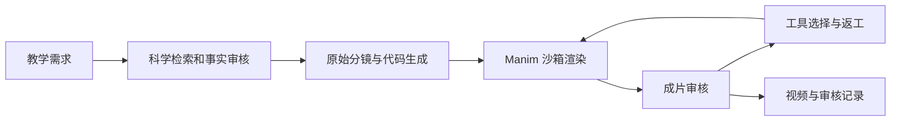

# BioVideoAgent V5.1

面向高中生物教学的动画生成实验。统一命令行和本地网页共享同一个生成入口。实际交付两段开发主题候选片，批准数为零。阶段 A 的批准门槛未达到，三个冻结后新主题未揭示、未执行。当前结果为 `BIOVIDEO_AGENT_PARTIALLY_VALIDATED`。



## 运行

使用项目既有 Linux、Python、Manim、FFmpeg 和沙箱环境，并将文本与视频审核模型配置放在环境变量中。服务器启动器从现有私有配置加载变量。渲染依赖服务器已有的沙箱启动器和隔离环境。

```bash
python generate_biology_video.py --request "Explain how enzymes bind substrates and catalyze reactions." --duration 30 --output outputs/enzyme
python experiments/biovideo_v5_1/launch.py --web 8765
```

网页地址为 http://127.0.0.1:8765。它提交与命令行相同的任务，读取实际工具轨迹、来源和审核状态。现场启动和提交路由已验证，实测任务因证据不具备教学机制支持而停止，当前任务播放器的端到端播放尚待验证。

## 实验与对照

| 主题 | 本轮智能体 | 原始系统历史对照 |
|---|---|---|
| 红细胞的形状与氧运输 | 18.2 秒，720p、30 帧/秒。审核认为画面未展示形状如何支持氧交换。智能体针对等直径比较选择返工，新代码渲染失败，原片保留。 | 13.27 秒，统一规则复审要求修改。 |
| 植物细胞的吸水、失水和坚挺度 | 28.5 秒，720p、30 帧/秒。初版因 Manim Flash 类型错误失败，经开发者更新通用恢复入口并辅助恢复后，模型选择返工并成功渲染。审核在 24–27 秒发现失水字幕和画面冲突。 | 35.93 秒，统一规则复审要求修改，逐项审核缺失。 |

两段本轮视频均经完整解码。生成码来自原始 Code2Video 的真实模型响应。事实表、证据定位、上下文哈希及成片绑定记录见各运行目录。生成采用同一个短分镜段落，返工可以重新生成该段，跨段连续性能力尚无验证。固定流程组在事实环节停止，植物片在通用修订后出片，因此无法作严格 G1/G2 增益判断。两个开发主题使用历史教材证据缓存。图注和替代文字实际进入原始生成提示，专业素材的像素利用及视觉增益未测量。

独立审核确认植物候选表现了动态机制。两次返工包含一次渲染级技术恢复和一次回滚，经独立复核通过的科学修复为零。真实工具选择已记录，三类执行式反事实对照尚未完成。当前预算按请求数计量，候选生成主路径不执行可选严格建模，尚未实现任务书要求的完整分阶段资源配额和实时金额上限。

## 用量与复现记录

DeepSeek 25 次，千问 4 次。输入 119,366、输出 40,441 Token。未取得实际账单。Wan 和 Seedance 本轮真实请求均为零。125 项回归通过。V5 基线为 `5de83df7a76a59b0bbe59064d324265c20abaf63`，初始开发运行版本为 `f06388d8341002f7d47f47826e22f50e38470504`，联调版本为 `3d2670446f800a7f650514c581170812b628e209`。保留首次失败和辅助恢复前后的结果。

打开 `videos/` 查看候选片，`keyframes.jpg` 查看关键帧，`comparisons/` 查看历史对照片及本轮审核。
