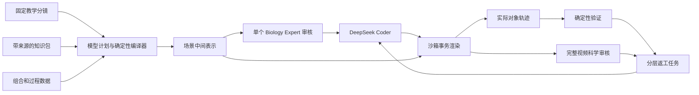

# 实际架构

V3 提供单个 BiologyExpertAgent、知识证据、代码/轨迹检查和事务渲染。V4 在 Coder 前增加可验证的科学场景表示，可信组件负责创建、绑定和执行真实对象。

`models.py` 定义组合、注册表、Schema验证；`scene_compiler.py` 编译真实模型事件计划和已准备过程数据；`state_machine.py` 对副本执行十类操作，条件失败不污染原状态；`validation.py` 注入谓词规则并核对实际锚点与身份；`provenance.py` 追踪标签首次出现阶段；`adapters/manim_adapter.py` 创建可编辑对象、实际位置绑定、动画与逐帧观测；`adapters/biology_expert_adapter.py` 将IR检查注册到既有单Agent，再调用科学语义审核；`tools/run_experiment.py` 是受预算约束的确定性实验驱动。

Agent 是已有有界策略的 BiologyExpertAgent，模型执行计划、代码和语义判断；Schema、编译、状态机、几何检查、沙箱渲染与预算均为确定性工具。未新增多Agent。审查意见不等于真实专家或高中生验证。

通用核心不按主题分支。科学事实在知识包；坐标与视觉在组合蓝图；合法科学过程在主题过程数据；实际观测单独记录。当前一个场景只实例化一个主要组合，轨迹仍是二维示意；没有原子化学结构、任意3D拓扑或完整六节生成能力。蓝图工程准备的贡献必须与模型贡献区分。
